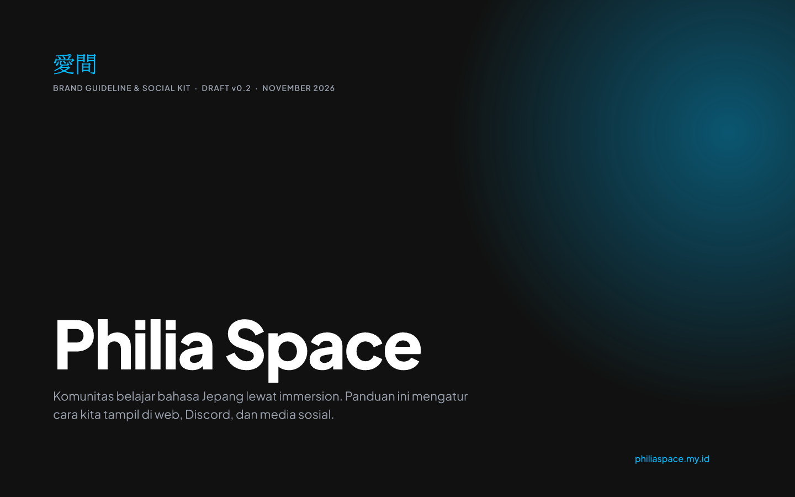
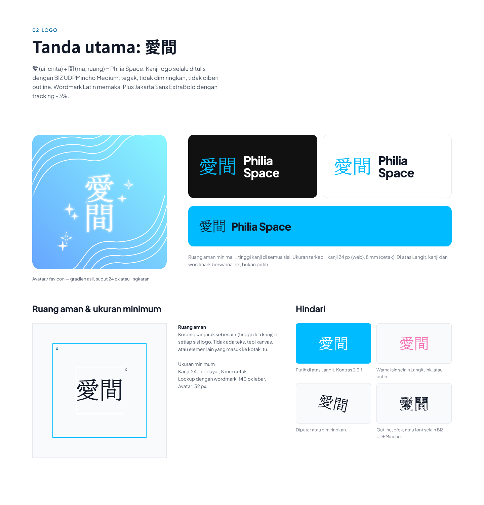
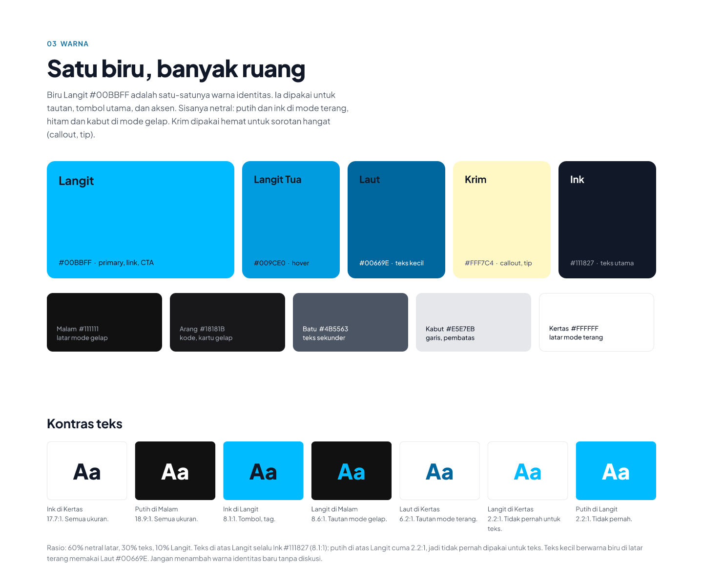
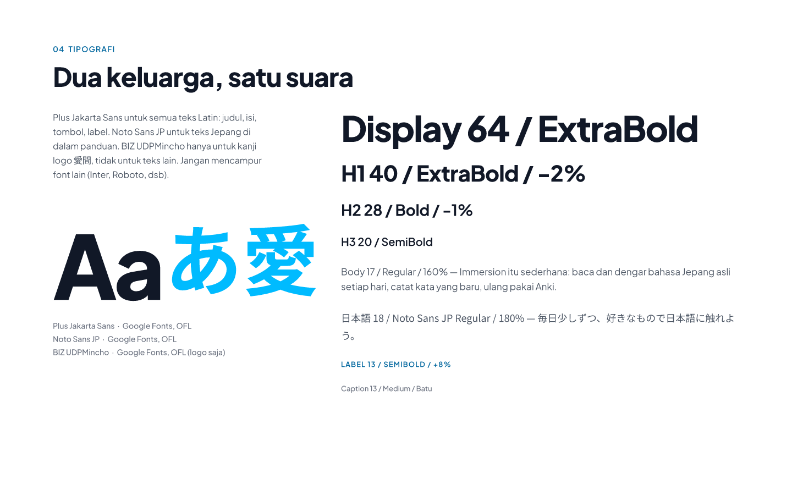
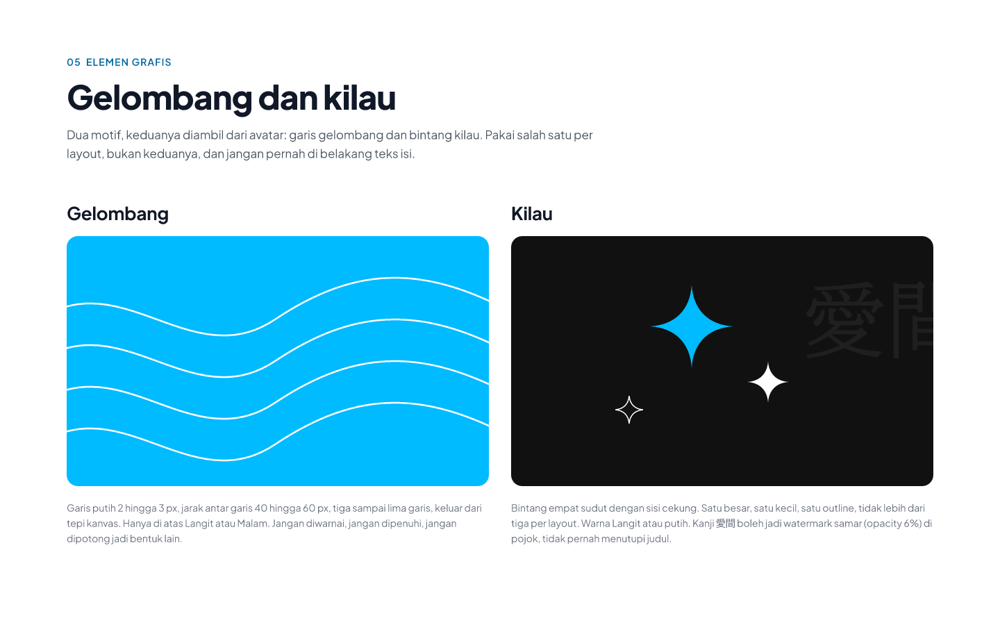
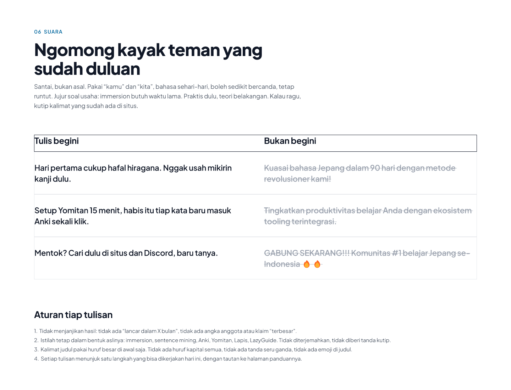
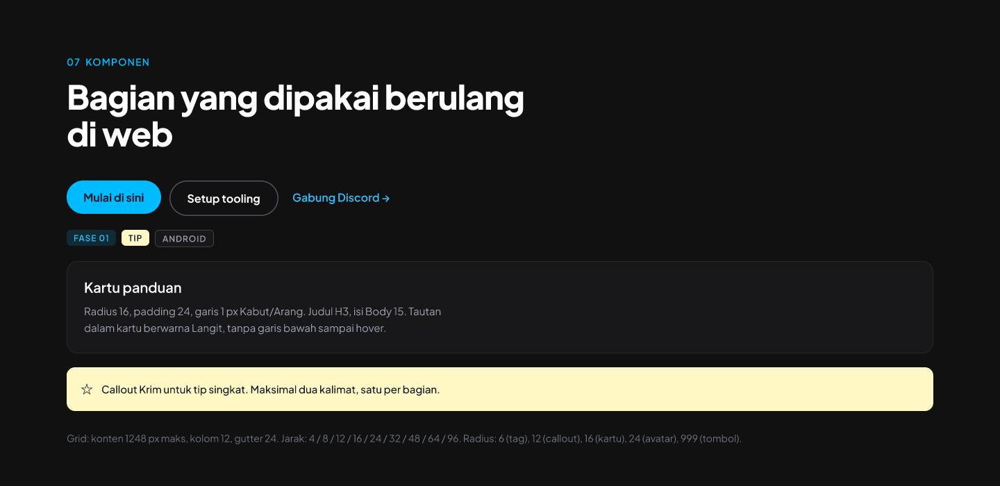
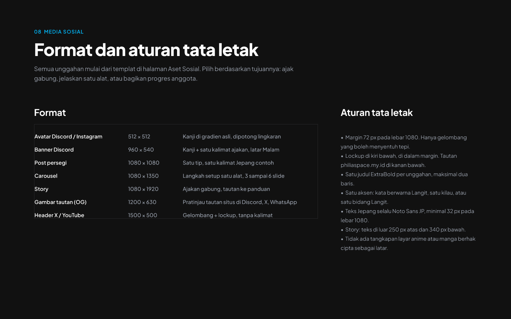
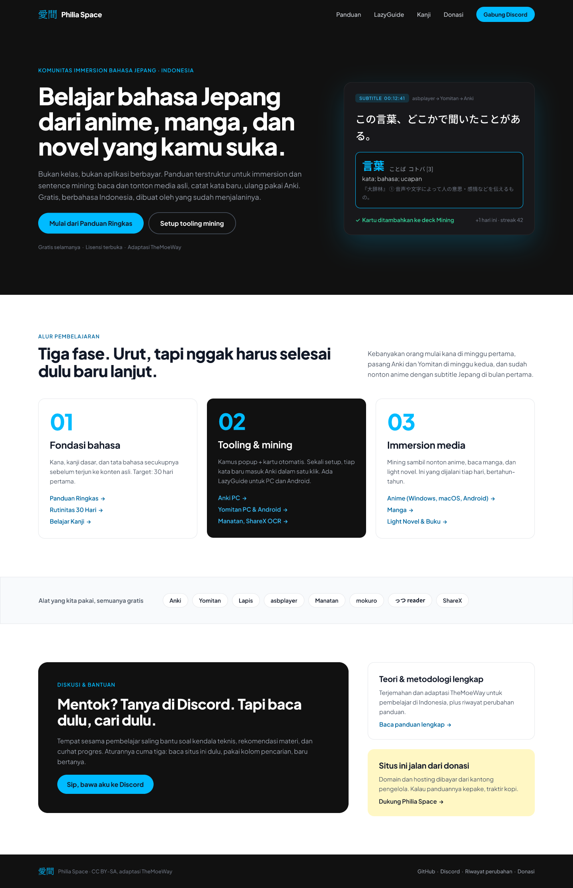
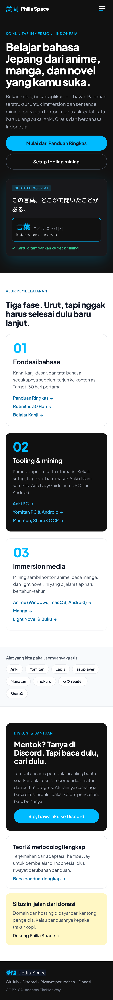

# Brand Guideline Philia Space

Pedoman identitas visual untuk philiaspace.my.id. Draft v0.2, November 2026, diekspor dari brand kit FigCraft.

## Ringkasan

**Warna.** Biru Langit `#00BBFF` adalah satu-satunya warna identitas: tautan, tombol utama, aksen. Sisanya netral.

| Nama | Hex | Dipakai untuk |
|---|---|---|
| Langit | `#00BBFF` | primary, link, CTA |
| Langit Tua | `#009CE0` | hover |
| Laut | `#00669E` | teks biru kecil di latar terang |
| Krim | `#FFF7C4` | callout, tip (hemat) |
| Ink | `#111827` | teks utama |
| Malam | `#111111` | latar mode gelap |
| Arang | `#18181B` | kode, kartu gelap |
| Batu | `#4B5563` | teks sekunder |
| Kabut | `#E5E7EB` | garis, pembatas |
| Kertas | `#FFFFFF` | latar mode terang |

**Kontras.** Teks di atas Langit selalu Ink (8.1:1). Putih di atas Langit cuma 2.2:1, jadi tidak pernah dipakai untuk teks. Rasio pemakaian: 60% netral latar, 30% teks, 10% Langit.

**Tipografi.** Plus Jakarta Sans untuk teks Latin, Noto Sans JP untuk teks Jepang, BIZ UDPMincho Medium hanya untuk kanji logo 愛間.

## Halaman guideline

| | |
|---|---|
|  |  |
| 01 Sampul | 02 Logo |
|  |  |
| 03 Warna | 04 Tipografi |
|  |  |
| 05 Elemen grafis | 06 Suara |
|  |  |
| 07 Komponen | 08 Media sosial |

## Draft landing page

| Desktop (1440) | Mobile (390) |
|---|---|
|  |  |

## Aset media sosial

| File | Ukuran | Dipakai untuk |
|---|---|---|
| [social-avatar-512.png](social/social-avatar-512.png) | 512 × 512 | avatar akun |
| [social-discord-banner-960x540.png](social/social-discord-banner-960x540.png) | 960 × 540 | banner server Discord |
| [social-og-1200x630.png](social/social-og-1200x630.png) | 1200 × 630 | gambar pratinjau tautan (Open Graph) |

## Sumber

File sumber `philiaspace-brand-kit.figcraft` tidak disimpan di repo ini. Kalau desain berubah, ekspor ulang dari FigCraft lalu timpa isi folder `brand/`, `landing/`, dan `social/` di sini. Nama file hasil ekspor mengikuti konvensi penamaan lintas platform di [README utama](../README.md): huruf kecil, angka, dan tanda hubung saja.
