# Panduan Bahasa Jepang

---

Diunggah: 10 Agustus 2025 – `Yaaacha`

---

??? warning "Perhatian <small>(klik di sini)</small>"
    - Panduan ini adaptasi dan lokalisasi dari [TheMoeWay](https://learnjapanese.moe/guide/), dengan referensi dan sumber belajar yang diganti ke versi bahasa Indonesia.
    - Kalau kamu nyaman baca panduan bahasa Inggris, versi aslinya ada di tautan itu.

*Mau langsung ke bagian praktik? Lompat ke [2.1 Cara belajar bahasa Jepang](#21-cara-belajar-bahasa-jepang).*

## 1.1 Mengapa banyak orang “gagal” belajar bahasa Jepang

Kebanyakan orang belajar bahasa Jepang dengan tujuan sederhana: bisa menikmati konten Jepang tanpa bergantung pada terjemahan, dan bisa ngobrol dengan lancar. Nyatanya banyak yang berhenti di tengah jalan padahal sudah belajar bertahun-tahun. Apakah bahasa Jepangnya yang terlalu sulit, atau usahanya yang kurang?

Dua-duanya bukan. Masalahnya ada di **cara belajarnya**.

Kelas tradisional saja tidak cukup untuk sampai ke tingkat yang benar-benar bisa dipakai. Banyak yang gagal karena melewatkan satu hal utama dalam rutinitas mereka: **immersion**, yaitu membaca atau mendengarkan konten asli yang dibuat oleh dan untuk penutur asli. Contohnya nonton anime tanpa takarir bahasa Indonesia atau Inggris, baca manga, atau dengarkan siniar (*podcast*) orang Jepang.

## 1.2 Masalah dengan metode tradisional

{: style="display: block; margin: 0 auto; max-width:40%; height:auto;" }

Pola belajar konvensional biasanya begini urutannya:

1. Hafalkan abjad (*hiragana*, *katakana*, lalu daftar *kanji*).
2. Hafalkan sapaan dan percakapan formal dasar.
3. Pelajari rumus tata bahasa (*bunpou*) dan hafalkan daftar kosakata lepas.
4. Coba susun kalimat sendiri lewat latihan soal, ngobrol dengan tutor, atau menulis esai pendek.
5. Terjemahkan kalimat bolak-balik antara bahasa ibu dan bahasa Jepang.
6. Tumpuk teori dari buku teks atau video penjelasan rumus.

Langkah-langkah ini berguna untuk pemahaman awal, tapi tidak akan membawamu ke tingkat mahir. Sebabnya: terlalu lama berteori tanpa bersentuhan langsung dengan bahasanya.

Ibarat belajar berenang, kamu tidak akan bisa kalau cuma berdiri di kolam dangkal pakai pelampung sambil menghafal teori ayunan tangan. Kamu harus nyebur ke kolam sesungguhnya. Dalam belajar bahasa, kolam sesungguhnya itu materi dari penutur asli.

!!! warning "Hindari jebakan materi pemula"
    Jangan terjebak berbulan-bulan di materi pengantar demi memastikan semua teori dasar dipahami sempurna. Kamu tidak akan pernah merasa "benar-benar siap" sampai kamu mulai nyebur ke konten aslinya.

Perfeksionisme sering jadi penghambat terbesar. Terlalu terpaku pada detail kecil memakan waktu yang seharusnya dipakai untuk menambah jam terbang. Buku teks dan teori itu seperti tali bantu saat mendaki gunung: berguna, tapi jalurnya tetap harus kamu daki sendiri.

## 1.3 Skala sebuah bahasa

Bahasa itu luas sekali. Nuansa, konteks budaya, dan keluwesan pemakaian penutur asli jauh melampaui rumus kaku "X artinya Y" di aplikasi atau lembar kerja.

Tanpa pengalaman langsung, kalimat yang kamu susun akan terasa ganjil bagi penutur asli, karena terbentuk dari terjemahan harfiah bahasa ibu. Tanpa mendengar langsung cara orang Jepang bicara sehari-hari, kamu juga akan kesulitan memahami percakapan wajar di luar contoh buku teks yang sudah disterilkan.

Di sinilah immersion bekerja: membiasakan otak menyerap pola bahasa langsung dari sumbernya.

Bahasa diperoleh lewat *comprehensible input* (masukan yang bisa dipahami), dan polanya terinternalisasi tanpa kamu sadari. Saat kamu paham maksud sebuah pesan di konten yang kamu nikmati, otak mencatat sendiri hubungan antarkata, konteks situasinya, dan struktur kalimatnya. Prosesnya sama seperti caramu memahami kalimat ini sekarang tanpa perlu membedah subjek, predikat, dan objeknya satu per satu.

## 1.4 Berdamai dengan ketidakpahaman awal

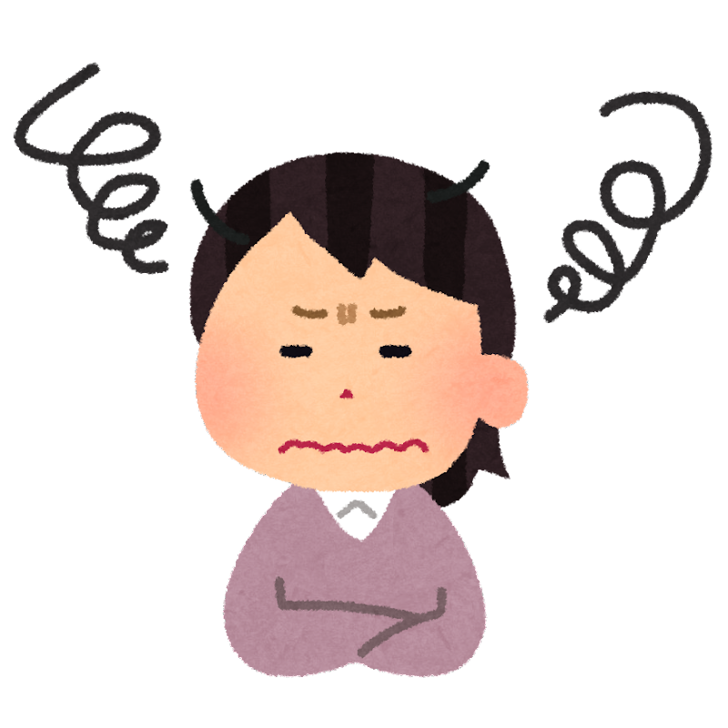{: style="display: block; margin: 0 auto; max-width:40%; height:auto;" }

Saat pertama kali pindah ke materi penutur asli, kamu akan kewalahan. Yang kamu pahami mungkin cuma 10% sampai 20%.

Rasa tidak nyaman ini fase wajar yang dilewati semua orang. Jangan berhenti cuma karena belum paham seluruh dialog di satu episode anime atau tiap kalimat di satu halaman buku. Kepekaan bahasa dibangun lewat pengulangan dalam konteks: satu kata sering baru benar-benar nyantol setelah kamu menemuinya di 4–5 kalimat yang berbeda.

Kuncinya: turunkan standar kesempurnaan, dan jaga paparan harianmu tetap konsisten.

---

## 1.5 Apa itu "immersion"?

**Immersion** adalah interaksi rutin dengan konten alami dalam bahasa target, yaitu konten yang **bukan** disederhanakan untuk pelajar asing, melainkan dibuat untuk dinikmati penutur asli bahasa Jepang.

- **Bukan immersion:** Mengerjakan soal pilihan ganda di buku teks atau mendengarkan rekaman latihan yang diperlambat.
- **Immersion:** Membaca manga, membaca novel web, menonton anime bertakarir bahasa Jepang, menyimak YouTuber Jepang, atau memainkan game berbahasa Jepang.

Dalam istilah teknisnya, ini disebut penyerapan *input*, dan dari sinilah otak membangun intuisi berbahasa.

## 1.6 Pendekatan *top-down*

Pendekatan *top-down* menuntutmu siap menerima ambiguitas. Berbeda dari penilaian kelas yang menghukum kesalahan sekecil apa pun, pendekatan ini fokus pada menangkap inti pesan walau kosakatamu masih terbatas.

Kamu tidak perlu menunggu sampai hafal semua kanji atau tamat semua buku tata bahasa sebelum mulai menikmati karya asli. Kuasai fondasi seperlunya (kana, tata bahasa ringkas, dan kosakata dasar), lalu pakai alat bantu seperti kamus sembulan (*pop-up dictionary*) untuk kata-kata yang belum kamu kenal di materi immersion.

---

## 2.1 Cara belajar bahasa Jepang

### Alur belajar pemula
Rutinitas pemula dibuat ringkas supaya kamu cepat sampai ke konten asli:

1. **Kuasai Hiragana dan Katakana** (biasanya 3 minggu sampai sebulan, tergantung orangnya).
2. **Hafalkan kosakata dasar dan kanji** dengan sistem pengulangan berjarak (*Spaced Repetition System*) lewat Anki.
3. **Pahami dasar tata bahasa (*bunpou*)** lewat panduan ringkas yang sudah dikurasi.
4. **Mulai rutinitas immersion harian** dengan konten ramah pemula yang kamu suka.

## 2.2 Hiragana dan Katakana

<figure>
  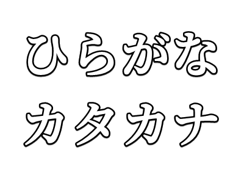
  <figcaption>"Hiragana" dan "Katakana" ditulis dalam bentuk tulisannya masing-masing.</figcaption>
</figure> 

Tulisan Jepang punya tiga komponen: *hiragana*, *katakana*, dan *kanji*. 

*Hiragana* dan *katakana* (keduanya biasa disebut **kana**) secara teknis adalah **silabari**, bukan alfabet. Tiap karakter mewakili satu mora atau suku kata (misalnya 「か」 dibaca "ka"), bukan satu konsonan.

### Hiragana
<figure>
  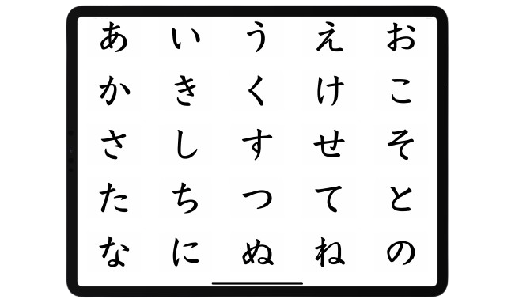
  <figcaption>Karakter hiragana dasar.</figcaption>
</figure>

Hiragana bentuknya melengkung dan jadi fondasi utama tulisan Jepang, terutama untuk:

- Partikel dan unsur gramatikal (*okurigana* di belakang kanji).
- Kosakata asli Jepang yang tidak punya kanji umum.
- Keterangan cara baca di atas kanji (*furigana*).

---

### Katakana
<figure>
  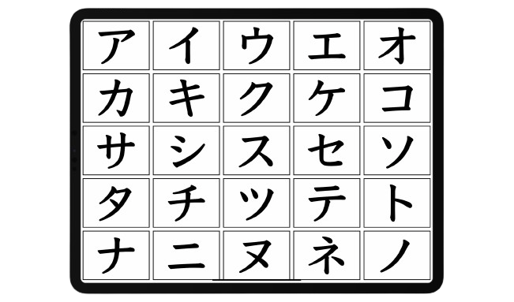
  <figcaption>Karakter katakana dasar.</figcaption>
</figure>

Katakana bentuknya bersudut tegas. Bunyinya sama persis dengan hiragana, tapi dipakai khusus untuk:

- Kata serapan asing (*gairaigo*, mis. 「テレビ」 - *terebi* / TV).
- Kata tiruan bunyi (*onomatope*).
- Penekanan visual, nama ilmiah flora/fauna, atau istilah gaul.

---

### Tahapan belajar *kana*

#### Langkah 1 - Amati tabel acuan
<figure>
  
  <figcaption>
      Tabel lengkap huruf kana tunggal 
      <a href="/img/hiragana_katakana_LARGE.png" target="_blank">Buka di peramban</a> | 
      <a href="/img/hiragana_katakana_LARGE.png" download>Unduh gambar</a>
  </figcaption>
</figure>

Simpan tabel ini sebagai contekan. Kolom mewakili bunyi vokal (A, I, U, E, O) dan baris mewakili konsonan (K, S, T, N, H, M, Y, R, W).

#### Langkah 2 - Video penjelasan fonetik
Tonton salah satu video berikut untuk mengenal bentuk huruf dan pelafalannya:

=== "Hiragana & Katakana (ENG)"
    <iframe width="100%" height="380" src="https://www.youtube.com/embed/_wZHqOghvSs" title="Video Panduan Hiragana & Katakana" frameborder="0" allow="accelerometer; autoplay; clipboard-write; encrypted-media; gyroscope; picture-in-picture; web-share" allowfullscreen style="border-radius: 8px; margin: 12px 0;"></iframe>

    [Tonton langsung di YouTube](https://youtu.be/_wZHqOghvSs){: target="_blank" }

=== "Hiragana (IDN)"
    <iframe width="100%" height="380" src="https://www.youtube.com/embed/nrv_iMuMLFk" title="Hiragana - Ryu Sensei" frameborder="0" allow="accelerometer; autoplay; clipboard-write; encrypted-media; gyroscope; picture-in-picture; web-share" allowfullscreen style="border-radius: 8px; margin: 12px 0;"></iframe>

    [Tonton langsung di YouTube](https://youtu.be/nrv_iMuMLFk){: target="_blank" }

=== "Katakana (IDN)"
    <iframe width="100%" height="380" src="https://www.youtube.com/embed/RZG9IjuF1zg" title="Katakana - Ryu Sensei" frameborder="0" allow="accelerometer; autoplay; clipboard-write; encrypted-media; gyroscope; picture-in-picture; web-share" allowfullscreen style="border-radius: 8px; margin: 12px 0;"></iframe>

    [Tonton langsung di YouTube](https://youtu.be/RZG9IjuF1zg){: target="_blank" }

---

#### Langkah 3 - Latihan pengenalan visual cepat
Pakai salah satu kuis web interaktif ini untuk melatih refleks baca:

- **[Latihan Interaktif Kana (DJT Guide)](https://djtguide.neocities.org/kana/){: target="_blank" }**
- **[Philia Shizen](https://philia-shizen.vercel.app/){: target="_blank" }**

**Panduan latihan:**

1. Buka menu opsi, pilih kategori *Hiragana*.
2. Tebak bunyi tiap karakter sampai akurasimu sekitar 80%.
3. Tambahkan variasi kombinasi (*dakuon*, *handakuon*, dan kombinasi *ya/yu/yo*).
4. Ulangi untuk *Katakana*.

Seluruh proses ini bisa makan 3 minggu sampai sebulan, tergantung orangnya. Jangan kecil hati kalau bagian ini terasa lama, karena sambil belajar kana kamu sudah bisa mulai hal lain seperti immersion tingkat pemula. Jangan pula menunda langkah berikutnya cuma karena sesekali masih bingung membedakan karakter mirip (seperti シ/ツ atau ソ/ン); matamu akan terbiasa sendiri begitu mulai membaca teks sungguhan.

---

#### Langkah 4 - Latihan membaca teks bertakarir (*graded readers*)
Setelah hafal karakternya satu per satu, latih kelancaran dengan bacaan tingkat dasar yang dilengkapi *furigana* (kana kecil di atas kanji):

Contoh:  
<ruby>日本語<rp>(</rp><rt>にほんご</rt><rp>)</rp></ruby> (*nihongo* - bahasa Jepang).

Pakai bacaan berjenjang gratis di **[Tadoku Graded Readers Level Start](https://tadoku.org/japanese/en/free-books-en/?level%5B%5D=l-start){: target="_blank" }**. Di tahap ini fokus saja pada kelancaran mengubah simbol jadi bunyi; artinya belum perlu dihafal.

---

## 2.3 Kosakata & Kanji

<figure>
  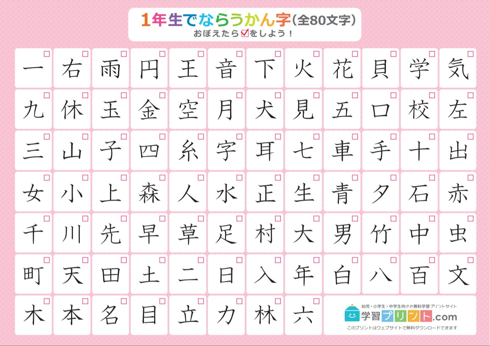
  <figcaption>80 kanji dasar tingkat awal di sekolah dasar Jepang.</figcaption>
</figure>

*Kanji* adalah karakter logografis asal Tiongkok yang diserap ke bahasa Jepang. Yang umum dipakai sehari-hari (*Jouyou Kanji*) ada sekitar 2.000 sampai 3.000 karakter.

Bedanya kana dan kanji:

- **Kana** murni fonetik: bunyinya tetap dan jumlahnya terbatas, jadi bisa dipelajari sekaligus secara terpisah.
- **Kanji** membawa makna, dan bacaannya (*onyomi* dan *kunyomi*) berubah tergantung kata tempat kanji itu dipakai.

Karena itu, **pelajari kanji langsung di dalam kata utuh, bukan sebagai simbol lepas**.

Menghafal daftar bacaan kanji tunggal tanpa contoh kata cuma membebani ingatan. Ambil kata **今日**: daripada menghafal bacaan 今 (*kon/ima*) dan 日 (*nichi/hi*) secara terpisah, jauh lebih gampang langsung menghafal **今日** yang dibaca **きょう** (*kyou*) dan berarti *hari ini*.

### Komponen dan radikal kanji
Kanji terlihat rumit kalau dilihat sebagai guratan acak, padahal tersusun dari komponen radikal yang berulang. 

Misalnya karakter **萌**: karakter ini disusun dari komponen rumput (艹), matahari (日), dan bulan (月). Mengenal komponen dasar membantu otak membedakan kanji yang bentuknya mirip. Kalau kamu butuh pengenalan visual komponen kanji, ada dek Anki berbasis komponen (bahasa Inggris) yang bisa diunduh [di sini](https://mega.nz/file/2SJiWC4b#hL98qtC_hiLlQDg0LqVJoqD2-5ywT2Nwd4kjROY_KwQ).

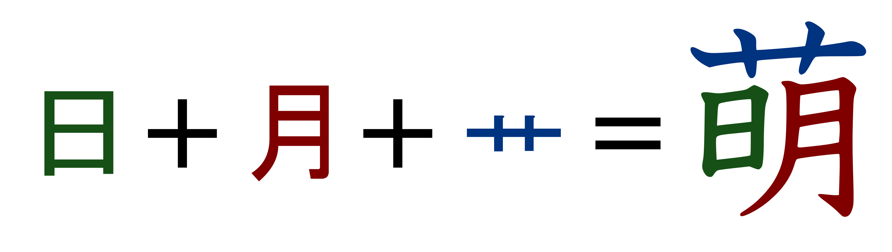

---

## 2.4 Belajar Kosakata dengan Anki

Untuk membangun kosakata awal dengan cepat, pakai dek kosakata frekuensi tinggi di aplikasi flashcard **Anki**. Dek ini berisi sekitar 1.500 kata yang paling sering muncul di percakapan dan media Jepang.

### Pemasangan Anki
1. Unduh dan pasang aplikasi resminya dari **[AnkiWeb](https://apps.ankiweb.net/#downloads){: target="_blank" }** sesuai sistem operasimu (Windows, macOS, Linux, atau AnkiDroid di Android). Semuanya gratis, kecuali AnkiMobile di iOS yang berbayar.
2. Unduh dek kosakata dasar:
   - **[Kaishi 1.5k (JP-EN)](https://github.com/donkuri/Kaishi/releases){: target="_blank" }** (versi rujukan utama).
   - **[Kaishi versi Bahasa Indonesia & Dek Komunitas](https://discord.com/channels/1370274344571240552/1386235512993611909/1386235512993611909){: target="_blank" }** (tersedia di server Discord Philia Space).
3. Buka Anki, pilih menu **Import File**, lalu pilih berkas `.apkg` yang tadi diunduh.

<figure>
  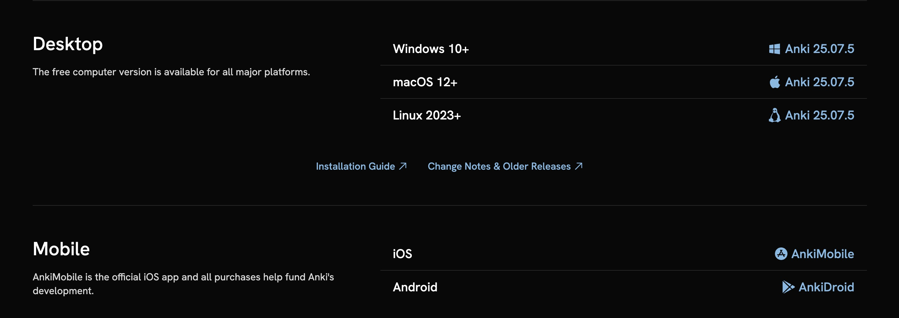
  <figcaption>Halaman unduh Anki. Pilih yang sesuai sistem operasimu; semuanya gratis kecuali AnkiMobile (iOS).</figcaption>
</figure>

### Konfigurasi optimal Anki (Algoritma FSRS)
Sebelum mulai, atur dek lewat ikon gir di samping nama dek:

1. Aktifkan penjadwal **FSRS** (*Free Spaced Repetition Scheduler*).
2. Atur **Desired Retention** ke `0.80` (80%). Angka ini seimbang antara daya ingat dan jumlah ulasan harian.
3. Batasi kartu baru di awal **10–15 kartu per hari**. Terlalu banyak kartu baru sekaligus bikin ulasan menumpuk (*review hell*), dan ujung-ujungnya kamu capek sendiri.
4. Samakan pengaturan tampilan dengan tab di bawah ini:

=== "Pengaturan 1"
    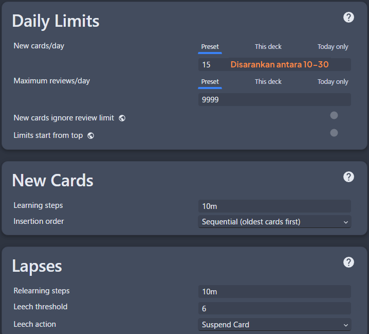{height=300 width=600}
=== "Pengaturan 2"
    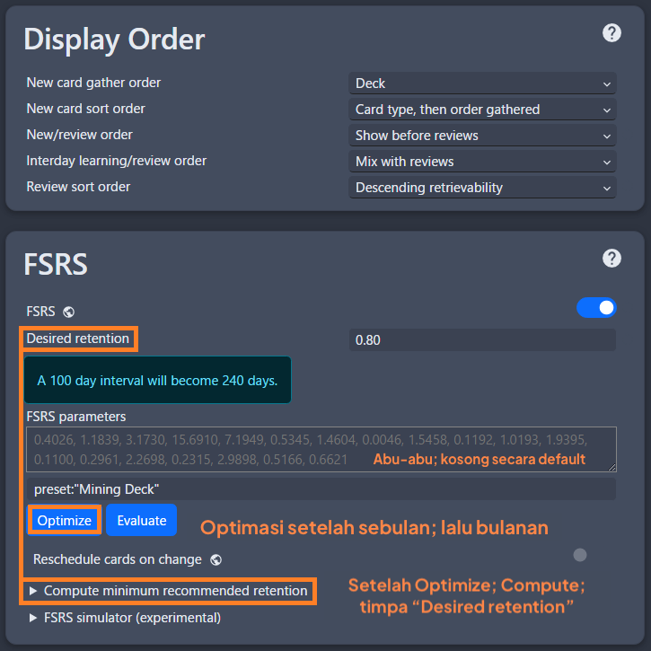{height=300 width=600}
=== "Pengaturan 3"
    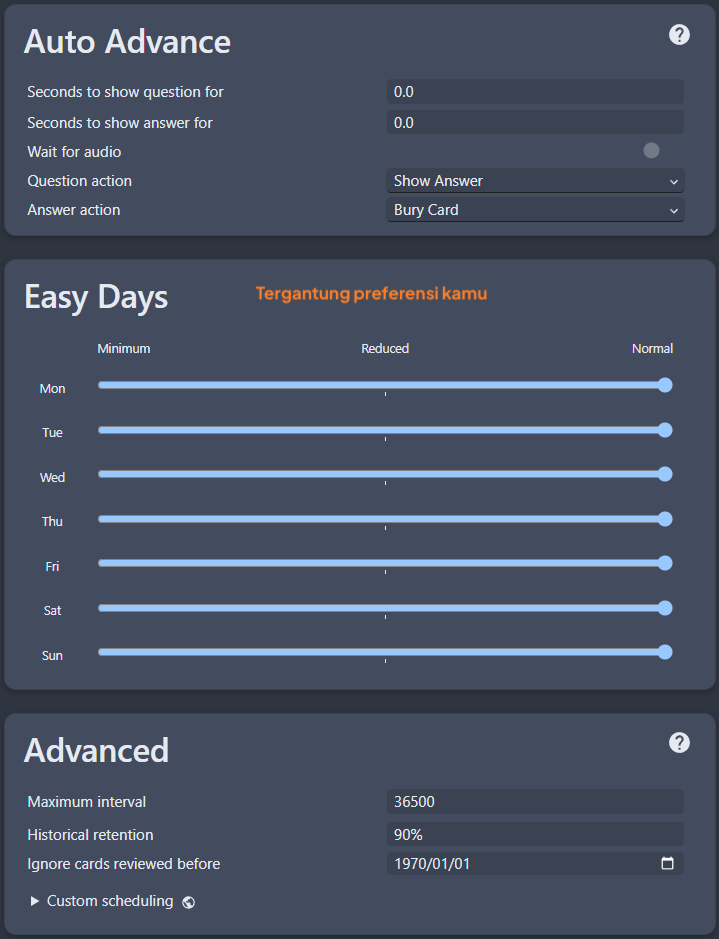{height=300 width=600}
=== "Preferensi Desktop"
    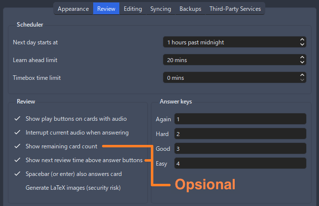{height=300 width=600}
=== "Preferensi Android"
    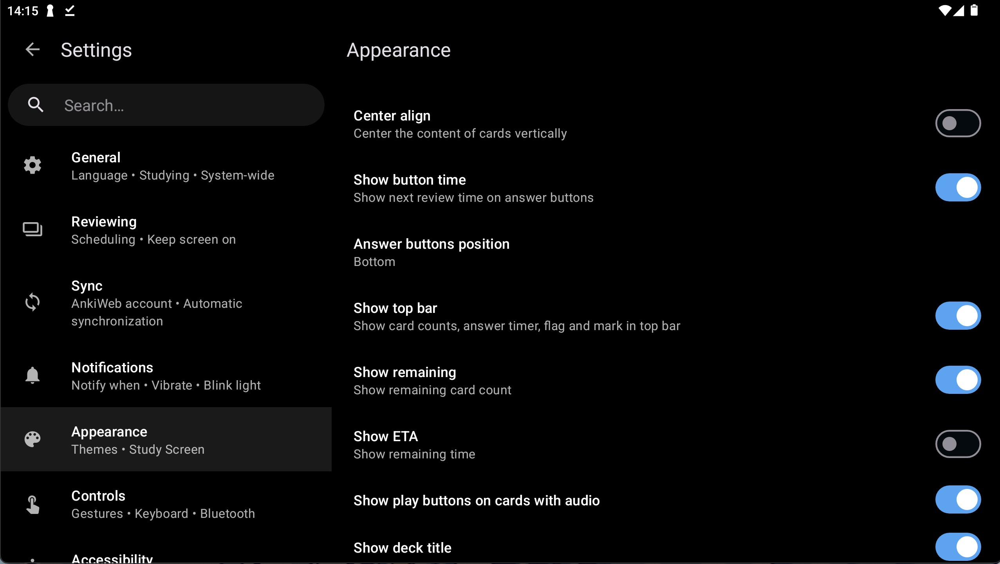{height=300 width=600}

### Prinsip penilaian kartu
Tujuan flashcard adalah menguji ingatan aktif terhadap **cara baca dan arti dasar** kata yang ditampilkan:

<figure>
  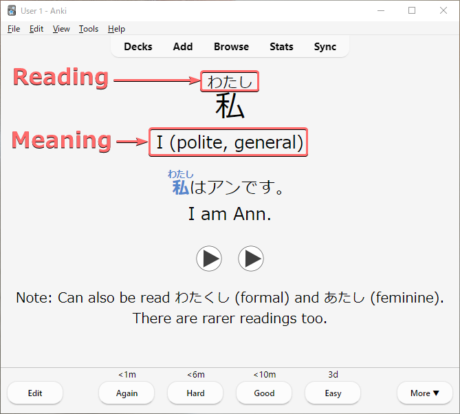
  <figcaption>Komponen informasi penting: kata target, cara baca kana, dan definisi ringkas.</figcaption>
</figure>

Nilainya gampang. Cuma dua tombol yang kamu pakai, dan aturannya satu: dua-duanya harus kena.

| Bisa baca | Tahu makna | Tekan |
| :---: | :---: | :--- |
| ✅ | ✅ | **Good** (lolos) |
| ✅ | ❌ | **Again** (gagal) |
| ❌ | ✅ | **Again** (gagal) |
| ❌ | ❌ | **Again** (gagal) |

Satu saja meleset, tekan Again. Jangan nawar pakai *Hard* atau *Easy*; kalau dua tombol itu sering dipakai, jadwal ulangannya jadi ngaco. Dan ulasan hari ini ya diselesaikan hari ini, jangan numpuk.

---

## 2.5 Bunpou (Tata Bahasa)

Dalam metode immersion, tata bahasa berfungsi sebagai **alat klarifikasi** (*clarification tool*), bukan kumpulan rumus untuk dihafal luar kepala. Tujuannya supaya kamu mengenali fungsi partikel dan struktur kalimat saat menemuinya di materi asli.

Pilih satu sumber yang paling nyaman buatmu:

| Bahasa Inggris | Bahasa Indonesia |
| :--- | :--- |
| **[Cure Dolly YouTube Playlist](https://www.youtube.com/playlist?list=PLg9uYxuZf8x_A-vcqqyOFZu06WlhnypWj)** ([transkrip](https://kellenok.github.io/cure-script/1-the-basic-types-of-sentences.html)) | **[Chakurin Fuufu (YouTube)](https://youtube.com/playlist?list=PL3MNfkiecePcNDeX9Ca06GSECT184ddoV&si=s4l6OLITx0_gxKin)** |
| **[Tae Kim's Guide to Japanese](https://guidetojapanese.org/learn/complete/writing)** | **[Yasashi Nihongo - MNN Dasar](https://youtube.com/playlist?list=PLhQ568NlkEK3ZGH0-nt7eCyynFsCLdBB5&si=CBmY6rMJX1rN6I7f)** |
| **[Japanese Ammo with Misa](https://www.youtube.com/playlist?list=PLd5-Wp_4tLqYZxS5j3g6kbeOfVXlTkr3N)** | **[Gakushudo no Nihongo](https://www.youtube.com/playlist?list=PLvVp7545yxgyAwuRIS-KTjFXbPM1jy0ST)** |
| **[Sakubi](https://sakubi.neocities.org/)** | **[Muzukashii Nihongo](https://www.youtube.com/@nassusensei/playlists)** |
| **[IMABI](https://imabi.org/)** | |

??? example "Tonton langsung playlist video tata bahasa (klik untuk melihat)"
    === "Cure Dolly (EN)"
        <iframe width="100%" height="380" src="https://www.youtube.com/embed/videoseries?list=PLg9uYxuZf8x_A-vcqqyOFZu06WlhnypWj" title="Cure Dolly Japanese Grammar" frameborder="0" allow="accelerometer; autoplay; clipboard-write; encrypted-media; gyroscope; picture-in-picture; web-share" allowfullscreen style="border-radius: 8px; margin: 12px 0;"></iframe>

    === "Chakurin Fuufu (ID)"
        <iframe width="100%" height="380" src="https://www.youtube.com/embed/videoseries?list=PL3MNfkiecePcNDeX9Ca06GSECT184ddoV" title="Chakurin Fuufu Tata Bahasa Jepang" frameborder="0" allow="accelerometer; autoplay; clipboard-write; encrypted-media; gyroscope; picture-in-picture; web-share" allowfullscreen style="border-radius: 8px; margin: 12px 0;"></iframe>

    === "Yasashi Nihongo (ID)"
        <iframe width="100%" height="380" src="https://www.youtube.com/embed/videoseries?list=PLhQ568NlkEK3ZGH0-nt7eCyynFsCLdBB5" title="Yasashi Nihongo Minna no Nihongo" frameborder="0" allow="accelerometer; autoplay; clipboard-write; encrypted-media; gyroscope; picture-in-picture; web-share" allowfullscreen style="border-radius: 8px; margin: 12px 0;"></iframe>

    === "Japanese Ammo with Misa (EN)"
        <iframe width="100%" height="380" src="https://www.youtube.com/embed/videoseries?list=PLd5-Wp_4tLqYZxS5j3g6kbeOfVXlTkr3N" title="Japanese Ammo with Misa" frameborder="0" allow="accelerometer; autoplay; clipboard-write; encrypted-media; gyroscope; picture-in-picture; web-share" allowfullscreen style="border-radius: 8px; margin: 12px 0;"></iframe>

Pelajari beberapa poin dasar, lalu segera perhatikan bagaimana pola itu muncul di konten yang kamu tonton atau baca.

---

## 2.6 Eksekusi Immersion untuk Pemula

Supaya immersion pemula bertahan lama, kuncinya ada di **pilihan materi yang benar-benar kamu suka**. Otak masih bisa bertahan dengan ketidakpahaman bahasa selama cerita atau visualnya tetap menghibur.

Jangan memaksakan diri ke materi edukatif anak-anak kalau kamu tidak menikmatinya. Makin banyak jam terbang, frasa yang awalnya terdengar samar akan terurai sendiri jadi pola yang jelas.

---

## 2.7 Strategi Mendengar dan Membaca

### Alat bantu membaca & kamus instan
Supaya tidak terus-terusan berhenti buka kamus saat membaca teks digital, pasang ekstensi peramban **Yomitan**:

- **[Panduan Lengkap Pemasangan Yomitan PC](setup-yomitan-pc-lazy-guide.md)**
- Kamus web: **[JIDict](https://jidict.vercel.app/){: target="_blank" }** (Jepang-Indonesia, bisa dipakai offline)

JIDict bisa dipasang sebagai aplikasi di HP, dan setelah itu jalan tanpa internet:

- **iOS:** buka di Safari, ketuk tombol **Bagikan** (kotak dengan panah ke atas), lalu pilih **Tambah ke Layar Utama**.
- **Android:** buka di Chrome, ketuk menu **⋮** di pojok kanan atas, lalu pilih **Instal aplikasi** (di beberapa versi tertulis **Tambahkan ke layar utama**).

### Pemilihan materi
Pilih media yang bikin kamu semangat: anime, drama, novel ringan (*light novel*), manga digital, novel visual (*visual novel*), atau YouTuber Jepang.

### Metode menyimak (*Listening*)
Menyimak itu hampir sepenuhnya *top-down* dan intuitif: jangan kebanyakan mikir, ikuti saja alurnya sampai ketemu momen yang pas untuk berhenti dan mencari arti. Ada tiga level:

| Level | Caranya |
| :---: | :--- |
| **1** | Dengarkan terus tanpa mencari arti apa pun. |
| **2** | Cari arti kata yang menonjol di telinga, tapi tontonan tetap jalan. |
| **3** | Pause di tiap kata yang tidak kamu tahu dan cari artinya satu per satu. |

Dari pemula sampai menengah, cukup level 1 dan 2. Nikmati tiap kesempatan kecil yang kamu dapat.

1. **Active Listening (Menyimak Aktif):** Perhatian penuh ke dialog dan visual. Di sini kepekaanmu terhadap intonasi dan bunyi berkembang paling cepat.
2. **Passive Listening (Menyimak Pasif):** Audio bahasa Jepang diputar sebagai latar saat kamu melakukan hal lain (di perjalanan, beres-beres kamar, atau olahraga). Berguna untuk menjaga telinga tetap akrab dengan ritme bahasanya di sela rutinitas.

### Metode membaca (*Reading*)
Membaca lebih analitis. Kamu pegang kendali penuh atas temponya. Alurnya sederhana:

**Baca kalimat → sorot kata sulit via Yomitan → pahami arti dalam konteks → lanjut baca.**

Pakai teks digital bertakarir bahasa Jepang (misalnya lewat alat bantu pemutar video seperti UsagiSpoon/asbplayer) atau manga digital yang teksnya bisa disalin.

### Rasio alokasi waktu
Di fase pemula, bagi waktunya **70% menyimak aktif dan 30% membaca**. Menyimak membangun kepekaan pelafalan dan memori pendengaran. Setelah kosakatamu sampai tingkat menengah, geser ke **50:50** supaya kemampuan membaca dan pemahaman lisan tumbuh beriringan.

---

## 2.8 Siklus Belajar Harian Pemula (*Daily Loop*)

Kesalahan umum yang harus dihindari: menamatkan semua kana, menghafal 1.500 kata Anki sampai tuntas, dan menamatkan semua buku tata bahasa dulu sebelum mencoba immersion.

!!! tip "Boleh mulai lebih awal"
    Sambil masih belajar kana, coba saja tonton sesuatu dalam bahasa Jepang tanpa takarir. Apa pun yang kamu suka, dan tidak perlu paham apa-apa dulu. Anggap ini buat ngepush diri sendiri supaya telinga mulai terbiasa.

Pakai alur harian yang berjalan bersamaan:

| Waktu | Kegiatan |
| :--- | :--- |
| **Pagi** | Tuntaskan ulasan Anki (15–20 menit). |
| **Siang** | Pelajari 1–2 poin tata bahasa dasar, lalu tambah 10 kartu Anki. |
| **Malam** | Immersion aktif 1–2 jam: nonton anime bertakarir JP, baca manga, atau dengerin podcast. |

Targetkan immersion minimal **1 sampai 2 jam per hari**. Sedikit tapi tiap hari jauh lebih berpengaruh daripada maraton 8 jam cuma di akhir pekan.

---

## 3.1 Soal Berbicara dan Menulis (*Output*)

Banyak orang mengira banyak bicara adalah cara jadi jago bahasa. Sebenarnya tidak begitu. Yang benar-benar bikin kamu berkembang adalah *input*: apa yang kamu dengar dan baca dari penutur asli. Tapi *output* tetap penting dilatih, lewat chat maupun bicara, karena keduanya jalan beriringan. Saat kamu mencoba bicara atau menulis, otak dipaksa memastikan ia benar-benar paham kata-kata yang kamu dengar, dan tanpa sadar kamu mulai mencari kesempatan memakai apa yang kamu temui di immersion.

Output rutin bersama input rutin, itu yang disarankan.

Berbeda dari banyak metode berbasis immersion lain, panduan ini tidak menganggap menunda output sampai "benar-benar jago" sebagai ide bagus, apalagi dengan alasan "ngomong salah bakal merusak bahasa Jepangmu". Menunda seperti itu bikin kamu kehilangan banyak kesempatan menangkap hal-hal yang bisa langsung kamu pakai, dan menanamkan perfeksionisme yang justru bikin kamu terlalu protektif pada bahasa Jepangmu sendiri.

Selama lebih dari 4 tahun menjalankan TheMoeWay dan ngobrol dengan berbagai pembelajar immersion, penulis aslinya jarang menemukan yang percaya diri dengan output-nya. Kenapa? Kebanyakan bahkan tidak mau mencoba sama sekali: takut salah ngomong, takut bahasa Jepangnya rusak, takut ditertawakan. Semua itu buah dari perfeksionisme yang sama, dan itu merugikan belajar lewat immersion.

## 3.2 Pelafalan dan *Pitch Accent*

Dibanding komunitas dan sumber belajar bahasa lain, sumber belajar, tutor, dan pembelajar bahasa Jepang cenderung menomorduakan pelafalan, karena pelafalan Jepang memang sederhana. Benar sederhana, dan benar kamu tidak perlu takut disalahpahami, tapi sebagian orang memang punya target pelafalan yang bagus.

Panduan ini ikut barisan yang bilang kamu tidak wajib belajar pelafalan: kalau kamu tidak terlalu peduli terdengar sempurna, tidak usah pusing soal pelafalan.

Kalau mau lebih dari itu, pelajari *pitch accent* dan pelafalan IPA yang benar secara mandiri, sebaiknya sedini mungkin.

## 3.3 Tolok Ukur Kemajuan Belajar

Buat yang penasaran, kira-kira begini kemampuan yang bisa kamu harapkan setelah melewati tahap-tahap ini:

- **10 serial anime tanpa takarir:** Kamu mulai terbiasa mendengar bahasa Jepang dan mungkin sudah paham sebagian besar kalimat. Anime yang kamu tonton di awal akan terasa beda sekali!
- **25 serial anime:** Mendengar bahasa Jepang terasa lebih alami dari sebelumnya.
- **50 serial anime:** Kalau belajarmu konsisten, kamu sudah tidak bisa disebut pemula lagi. Bedanya dengan saat kamu mulai akan terasa jauh sekali!
- **1 novel selesai dibaca:** Buku ini pasti berat, tapi kamu mulai benar-benar lepas dari tahap pemula. Buku berikutnya akan terasa jelas lebih mudah.
- **5 novel / 1 novel visual sedang-panjang:** Kamu bukan pemula lagi. Kemampuan membacamu mulai terbentuk dengan baik.
- **10 novel / 2 novel visual sedang-panjang:** Sudah benar-benar tingkat menengah. Selamat!

## 3.4 Penutup: Lepas dari Tahap Pemula

Selebihnya tidak banyak: immersion sebanyak-banyaknya, pelajari kata dan tata bahasa. Dengan metode ini kamu benar-benar bisa fasih. Tapi ada satu hal yang berubah setelah kamu lepas dari tahap pemula.

Belajar kosakata dengan Anki jadi jauh lebih personal, karena kamu akan membuat kartu sendiri dari kata-kata yang kamu temui di immersion. Proses ini disebut **mining**, dan mining akan jadi jantung belajar bahasa Jepangmu. Panduan teknisnya ada di **[Panduan Mining Lazy Guide](setup.md)**; versi aslinya di [panduan mining Donkuri](https://donkuri.github.io/learn-japanese/mining/){: target="_blank" }.

Terima kasih sudah meluangkan waktu membaca panduan ini. Semoga lancar belajar bahasa Jepangnya!

Kalau ada pertanyaan, tanya saja di server Discord kami.

[Gabung Discord :fontawesome-brands-discord:](join.md){: .md-button }

### Trakteer
Kalau panduan ini berguna buat perjalanan belajarmu, dukungan lewat Trakteer sangat kami hargai:

[Trakteer Philia Space](https://trakteer.id/philiaanimelist/tip){: .md-button }

### Kontributor Panduan Asli
Terima kasih kepada semua yang ikut menyusun panduan asli TheMoeWay:

iamatryhard · shigatsunoraion · qazsedctgb · ktamashi · kaio.n · saegusa.mayumin · pedipanol · .ikki. · ultravioletspring · deviru · kazuhira___ · marv.n
